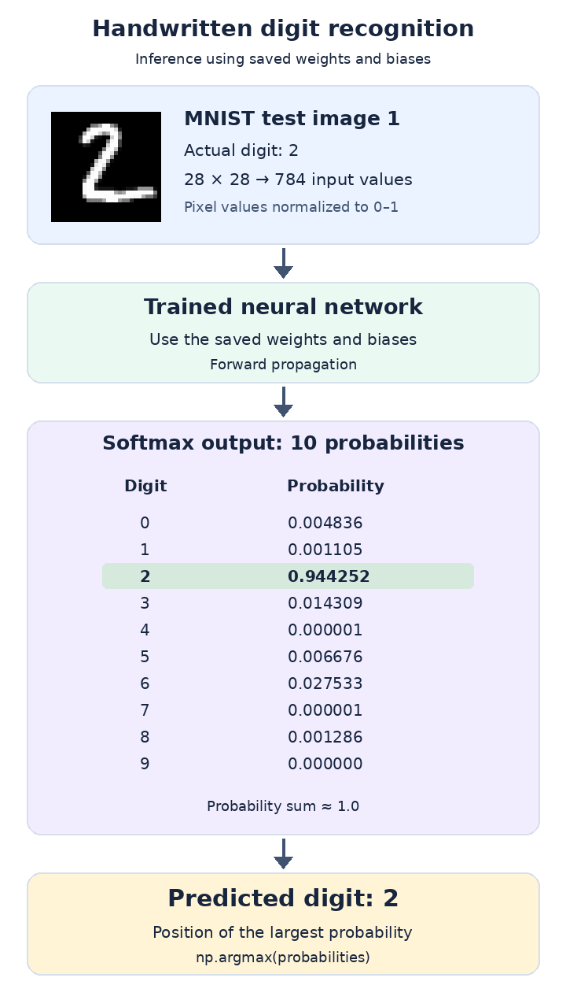
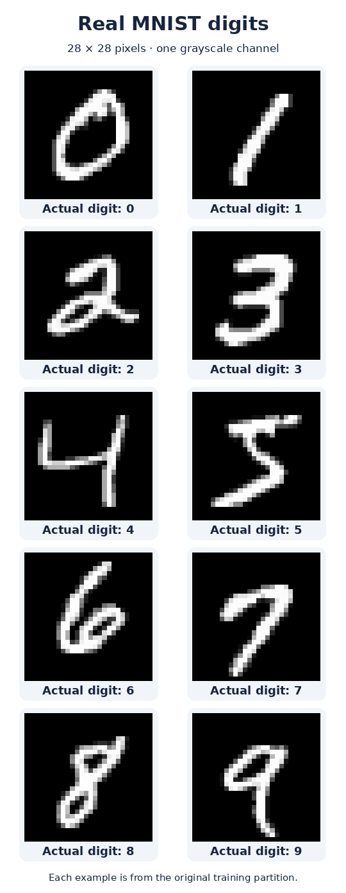
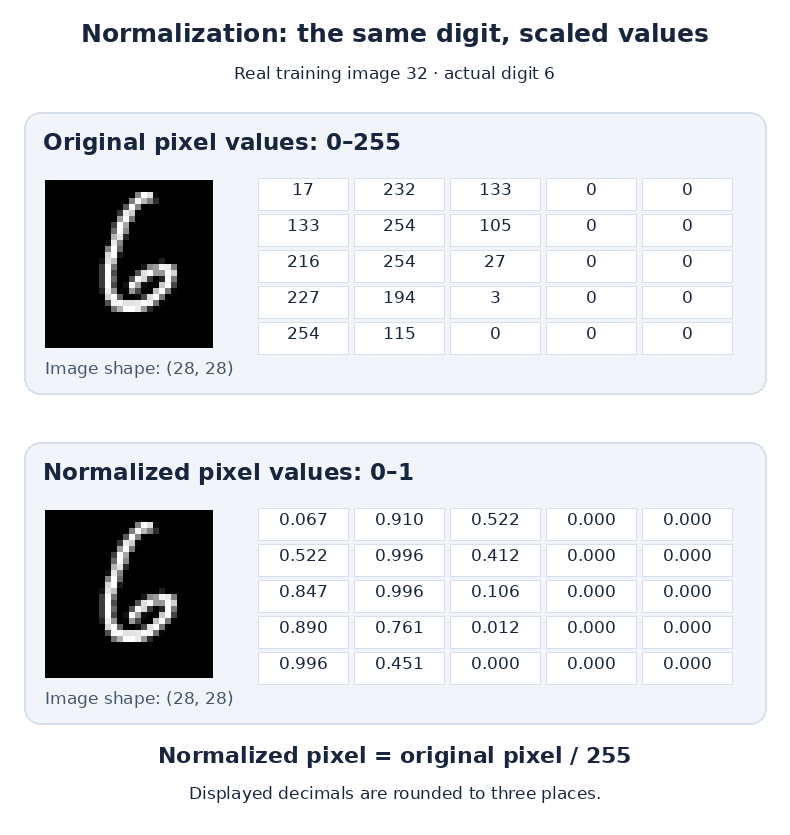

# MNIST Handwritten Digit Recognition

A practical introduction to handwritten digit recognition using the **real MNIST dataset** and an **already trained neural network**. Each concept is connected to runnable Python code, visible images, and observed results.

The lesson covers image data, labels, reshaping, normalization, loader options, forward propagation, softmax probabilities, and the predicted digit.



## Run the exercises

Clone or download this repository, then open a terminal inside its folder.

```bash
git clone https://github.com/hakrosabir/mnist-digit-recognition.git
cd mnist-digit-recognition
python -m pip install -r requirements.txt
```

Run the exercises in this order:

```bash
python mnist_step1.py
python mnist_options.py
python mnist_predict.py
python mnist_predict.py --index 0
```

The first run obtains the original MNIST data if it is absent, then stores a local cache. Subsequent runs reuse that cache. The scripts need **Python 3, NumPy, and Pillow**.

| File | What you learn |
| --- | --- |
| [mnist_step1.py](mnist_step1.py) | Load MNIST, inspect shapes, display a digit, and normalize its pixels |
| [mnist_options.py](mnist_options.py) | Compare image shapes and single-digit versus one-hot labels |
| [mnist_predict.py](mnist_predict.py) | Use saved parameters to produce ten probabilities and a prediction |
| [mnist_lesson.ipynb](mnist_lesson.ipynb) | Work through the full explanation with editable code and saved outputs |

For a terminal-only run, use `python mnist_step1.py --no-show` and `python mnist_predict.py --no-show`. These print the same calculations without opening an image viewer.

## 1. The recognition problem

We want to classify a handwritten digit image as one of **ten classes: 0 through 9**.

Training has already been completed. The saved **weights and biases** contain the network's trained parameters. We use those parameters to calculate the output for a new input image. This prediction calculation is called **inference**, or **forward propagation**.

`assets/sample_weight.pkl` contains the trained parameters used in these exercises.

## 2. The MNIST dataset

MNIST contains handwritten digit images from **0 to 9**:

- **60,000 training images**.
- **10,000 test images**.
- Each image has an actual digit label.



Every image is **28 × 28 pixels**, so it contains **784 pixel values**. It has **one grayscale channel**. Original pixel values range from **0 to 255**: 0 is black, 255 is white, and intermediate values are shades of gray.

We use the book's original loader:

```python
from dataset.mnist import load_mnist

(x_train, t_train), (x_test, t_test) = load_mnist(
    flatten=True,
    normalize=False,
    one_hot_label=False,
)
```

| Array | Shape with these settings | Meaning |
| --- | --- | --- |
| `x_train` | `(60000, 784)` | Training images; one row of 784 values per image |
| `t_train` | `(60000,)` | One actual digit label per training image |
| `x_test` | `(10000, 784)` | Test images |
| `t_test` | `(10000,)` | One actual digit label per test image |

Loading these arrays reads the dataset. The trained parameters are loaded separately for inference.

## 3. Displaying an image

```python
import numpy as np
from PIL import Image

index = 0
img = x_train[index]
label = t_train[index]

print(label)      # 5
print(img.shape)  # (784,)

img = img.reshape(28, 28)
print(img.shape)  # (28, 28)

Image.fromarray(np.uint8(img)).show()
```

`x_train[index]` selects an image, and `t_train[index]` selects its corresponding correct label. Index 0 selects the first example; index 1 selects the second.

`reshape(28, 28)` arranges the same 784 values into 28 rows and 28 columns. The pixel values and the digit remain the same.

Pillow converts the array into an image and opens it for display. The first script also saves the image to `outputs/first_digit.png`.

**Try it:** change `index = 0` to `index = 1` in `mnist_step1.py`, save the file, and run it again. The second training image has label **0**.

## 4. Pixel values and normalization

Normalization scales original pixel values from **0–255** to **0–1**:

```python
normalized_img = img.astype(np.float32) / 255.0
```

`astype(np.float32)` converts the pixel values to decimal numbers. Dividing by 255 scales those numbers.

| Original value | Value after division by 255 |
| --- | --- |
| 0 | 0.000000 |
| 17 | 0.066667 |
| 128 | 0.501961 |
| 232 | 0.909804 |
| 254 | 0.996078 |
| 255 | 1.000000 |



The figure uses the same real image and 5 × 5 pixel region inspected during the hands-on exercise. Both the original and normalized arrays keep the shape `(28, 28)`.

The loader performs this scaling automatically with `normalize=True`. For inference, use the same input scaling as the trained network. The included network's example uses normalized inputs.

## 5. The three loader options

| Option | `True` | `False` |
| --- | --- | --- |
| `normalize` | Pixel values from 0.0 to 1.0 | Original pixel values from 0 to 255 |
| `flatten` | One flat array of 784 values per image | Keep image dimensions and the grayscale channel |
| `one_hot_label` | Ten values per label, with one position set to 1 | One digit per label |

### Flattened and image-shaped arrays

With `flatten=True`, one image has shape `(784,)`, and the training image array has shape `(60000, 784)`.

With `flatten=False`, this exact loader returns one image with shape `(1, 28, 28)`, and the complete training array has shape `(60000, 1, 28, 28)`. The **1** represents the grayscale channel. Each image still has 28 rows and 28 columns.

### Single-digit and one-hot labels

With `one_hot_label=False`, the first training label is `5`, and the label array has shape `(60000,)`.

With `one_hot_label=True`, that same label becomes:

```text
[0. 0. 0. 0. 0. 1. 0. 0. 0. 0.]
```

The 1 is at position **5**, identifying the correct digit. The complete label array now has shape `(60000, 10)`.

These are two formats for the same dataset labels. The network's output probabilities are calculated separately.

## 6. Forward propagation with the trained network

The inference script loads the saved parameter file:

```python
import pickle
from pathlib import Path

with open(Path("assets") / "sample_weight.pkl", "rb") as file:
    network = pickle.load(file)
```

The prediction calculation uses the trained weights `W1`, `W2`, and `W3`, and the trained biases `b1`, `b2`, and `b3`:

```python
def predict(network, x):
    W1, W2, W3 = network["W1"], network["W2"], network["W3"]
    b1, b2, b3 = network["b1"], network["b2"], network["b3"]

    a1 = np.dot(x, W1) + b1
    z1 = sigmoid(a1)

    a2 = np.dot(z1, W2) + b2
    z2 = sigmoid(a2)

    a3 = np.dot(z2, W3) + b3
    return softmax(a3)
```

At each layer, the calculation uses the previous values, the saved weights, and the saved biases. The hidden layers apply sigmoid, and the output layer applies softmax.

For this network, the loader settings used for inference are:

```python
load_mnist(normalize=True, flatten=True, one_hot_label=False)
```

One input has shape `(784,)`.

## 7. Ten outputs and the predicted digit

This is a **10-class classification problem**, so the output layer has **10 neurons**, corresponding to digits **0–9**.

Softmax converts the output values into probabilities. Together, these probabilities sum to approximately 1. The digit with the largest probability is the predicted digit.

```python
probabilities = predict(network, x)
predicted_digit = int(np.argmax(probabilities))
```

`np.argmax` returns the position of the largest probability. Because positions correspond to digits 0–9, that position identifies the predicted digit.

### Verified example: test image 1

Run `python mnist_predict.py`. The actual label is **2**.

| Digit | Output probability |
| --- | --- |
| 0 | 0.004836 |
| 1 | 0.001105 |
| **2** | **0.944252** |
| 3 | 0.014309 |
| 4 | 0.000001 |
| 5 | 0.006676 |
| 6 | 0.027533 |
| 7 | 0.000001 |
| 8 | 0.001286 |
| 9 | 0.000000 |

The displayed values are rounded to six decimal places. Digit **2** has the largest probability, so the prediction is **2**.

### Verified example: test image 0

Run `python mnist_predict.py --index 0` to select the first test image.

| Test index | Actual digit | Predicted digit | Largest output probability |
| --- | --- | --- | --- |
| 1 | 2 | 2 | 0.944252 |
| 0 | 7 | 7 | 0.997065 |

Both examples were executed successfully during the lesson. The complete calculated values are preserved in [examples/prediction-results.json](examples/prediction-results.json).

## Full notebook and supplied guide

[mnist_lesson.ipynb](mnist_lesson.ipynb) contains all explanations, code cells, and outputs from a verified execution. Open it in a Jupyter-compatible editor. To use Jupyter locally:

```bash
python -m pip install notebook
python -m notebook mnist_lesson.ipynb
```

Run its cells from top to bottom. Keep the notebook inside the repository folder so it can import the dataset loader and locate the trained parameters.

The [supplied lesson guide](assets/lesson-guide.png) is also included. Its output probabilities are illustrative; this repository's results use real network calculations.

## Working in Windows Command Prompt

Terminal commands run Python files:

```bash
python mnist_step1.py
```

Python statements such as `img = x_train[0]` belong inside a Python file or notebook cell. To edit the first script from Command Prompt:

```bash
notepad mnist_step1.py
```

Save with Ctrl + S, then run the script again.

## Data and source credit

- MNIST loader and trained weights: [Koki Saitoh / O'Reilly Japan, Deep Learning from Scratch](https://github.com/oreilly-japan/deep-learning-from-scratch).
- Dataset loader: [dataset/mnist.py](https://github.com/oreilly-japan/deep-learning-from-scratch/blob/master/dataset/mnist.py).
- Forward propagation reference: [ch03/neuralnet_mnist.py](https://github.com/oreilly-japan/deep-learning-from-scratch/blob/master/ch03/neuralnet_mnist.py).
- Trained parameter file: [ch03/sample_weight.pkl](https://github.com/oreilly-japan/deep-learning-from-scratch/blob/master/ch03/sample_weight.pkl).
- Original MIT notice: [third_party/KOKI_SAITOH_LICENSE.md](third_party/KOKI_SAITOH_LICENSE.md).
- Included upstream file checksums: [third_party/SOURCES.json](third_party/SOURCES.json).

The original loader obtains the four MNIST gzip files from its configured mirror and caches the arrays locally. `.gitignore` excludes downloaded data, the dataset cache, image-viewer outputs, and Python caches from Git commits.

See [THIRD_PARTY_NOTICES.md](THIRD_PARTY_NOTICES.md) for the source details.
